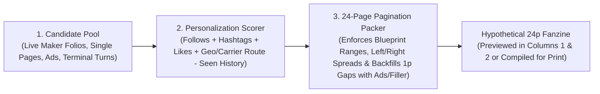

# bqopd `/publisher` Architecture & Long-Term Plan

Living design document for the `/publisher` production desk, the 24-page personalized feed/packing algorithm, and the modular refactor of `publisher_panel.dart`.

---

## 1. Core Mental Model: Maker vs. Publisher

Right now, `publisher_panel.dart` blurs two distinct concepts by creating a static `type: 'folio'` fanzine with 24 blank `basic_text` pages and linking each scheduled zine out to `/${shortCode}/maker`.

Here is the true separation of concerns:

| Workspace | Who Uses It | What It Produces | Output Artifact |
| :--- | :--- | :--- | :--- |
| **`/maker`** (Profile Maker) | Individual creators / users | Static UGC **pages** and **folios** (art, essays, letters, comics, ads, with `sidePreference: left / right / either`). | Concrete `Fanzine` (folio) & `images` pool entries with metadata (author, location/geohash/carrier route, hashtags, engagement stats). |
| **Programmatic Engines** | System / Game loops (e.g., Combat Terminal) | Per-recipient dynamic pages ("3 frames/week" game state turns, radius letter maps, local calendars, dynamic indicia). | Generated page plates or renderable page payloads keyed to `(recipientId, weekId)`. |
| **`/publisher`** (Production Desk) | Publisher / Print Run Coordinator | **24-Page Fanzine Blueprints (Issue Templates)** & **Weekly 3-Zine Bundles (72p)**. | **1)** Blueprint rules defining *how* each of the 24 page slots is filled per recipient. **2)** Hypothetical/Simulated 24-page fanzines previewed in Columns 1 & 2 (including "Preview as [User]"). **3)** Compiled per-recipient fanzine instances (`3 × 24p = 72p`) for everyone on that week's circulation list. |

---

## 2. How Personalized Weekly Bundles Work ("24-Page Instagram Feed + Pagination")

1. **Weekly Bundle = 3 Fanzine Blueprints × 24 Pages = 72 Pages per Recipient**
   - Every recipient on a week's Circulation list receives **3 unique 24-page fanzines** assembled specifically for them.
   - Getting a fanzine is effectively like getting the **top 24 pages of your personalized social feed**, constrained by physical saddle-stitch pagination rules (`left` vs. `right` pages, 2-page spreads, turn reveals, and ad/filler padding).

2. **Slot-Based Page Rules & Fallbacks**
   - **Conditional Programmatic Slots (e.g., Pages 7–10 = Combat Terminal):**
     - *If `recipient.playsTerminalGame == true`:* Insert the player's weekly Combat Terminal turn output pages.
     - *Fallback (`else`):* Fall back to **General UGC** so the zine always stays strictly 24 pages.
   - **Range Buckets + Interleaved Ads/Fillers (e.g., Pages 3–15 = Global UGC, Pages 16–17 = Local/Carrier-Route UGC):**
     - Rather than forcing all Ads into one rigid section and all UGC into another, a UGC range packs multi-page Maker folios + single pages in order of feed score.
     - **Pagination & Blank-Slot Backfilling:** When a multi-page Maker folio requires a specific alignment (e.g., a 2-page spread that must start on an even `left` page, or a page-turn reveal that leaves a single blank page before it), the **Pagination Packer** automatically fills that resulting 1-page gap with a 1-page **Ad**, **Filler**, or **Single-Page UGC** item!

3. **Columns 1 & 2 in `/publisher`: Hypothetical Fanzine & User Simulation**
   - Clicking a zine in **"This week's fanzines"** (or creating one) stays inside `/publisher` (never redirecting to `/maker`).
   - **Columns 1 & 2** render the **hypothetical 24-page fanzine** generated by the active Blueprint template.
   - **Recipient / User Selector:** A picker lets you select any user (or circulation recipient) to immediately see how their **follows, likes, hashtag affinities, location, and game state** change the 24-page content mix in real time.

---

## 3. Where Should the Assembly Algorithm Live? (Dart vs. Cloud Functions)

You already established a brilliant pattern in this repo for Typography Layout (`PublisherLayoutEngine` in `bqopd_core` + `PageDisplayList` -> rendered for instant preview in the browser, and executed in Python `functions/main.py` for heavy batch compilation).

We should use that exact **Two-Part Split** for the Fanzine Assembly Algorithm:

### Part A: Signal Collection & Candidate Scoring (Firestore + Cloud Functions)
- **What it tracks:** Likes (`Users/{uid}/activity/likes`), comments, follows (`profiles/{uid}/following`), hashtag interactions, creator affinities, geohash / carrier-route proximity, and a **`receivedPages` history** (so a user is never printed the same UGC page twice).
- **Where it lives:** Lightweight user affinity profile in Firestore (e.g., `Users/{uid}/feed_profile/summary` with top followed creators, top hashtags, home geohash/carrier route) + candidate query in Cloud Functions / Firestore.

### Part B: The Deterministic 24-Page Blueprint Packer (`bqopd_core` in Pure Dart!)
- **Why pure Dart in `packages/bqopd_core` (`FanzineBlueprintEngine`):**
  1. **Instant Interactive Preview in `/publisher` (Jaspr):** When you tweak a template rule in Column 3 or switch the "Preview as [User]" dropdown, Columns 1 & 2 can run the Dart engine **in <5 milliseconds right in the browser** to show the exact 24-page spread layout, which folios landed on which spreads, and where 1-page ad/filler gaps were auto-filled!
  2. **Shared with `bqopd_flutter` & Server:** Because `bqopd_core` is pure Dart, both your Jaspr server/client and Flutter app can run the exact same algorithm.
  3. **Batch Print Run Execution:** When it's time to lock and generate the actual weekly print run for 100+ circulation recipients, either the Jaspr server or a Cloud Function (`compile_weekly_bundle`) can execute or mirror the exact same deterministic slot-packing rules to write the final recipient folios.

---

## 4. How the 2-Stage Algorithm Works

1. **Stage 1 — Candidate Scoring (The "Instagram Feed" Ranker):**
   For a target `User` and a `SlotRule` (e.g. `global_ugc` or `local_ugc`):
   $$\text{Score}(\text{item}, \text{user}) = w_{\text{follow}} \cdot \text{isFollowedCreator} + w_{\text{tag}} \cdot \text{hashtagOverlap} + w_{\text{geo}} \cdot \text{geoProximity} + w_{\text{eng}} \cdot \log(1 + \text{likes} + 2\cdot\text{comments}) + w_{\text{fresh}} \cdot \text{recencyDecay}$$
   *(Filter out any folio/page in `user.receivedPageIds` so they never get duplicates).*

2. **Stage 2 — The 24-Page Spread/Pagination Packer:**
   Walks pages `1..24` (Spreads `1..13`):
   - Evaluates the Blueprint rule for the current page/range (e.g. Cover, Terminal if player else UGC, Global UGC, Local UGC).
   - Picks the highest-scoring candidate folio/page that fits the remaining pages in the range.
   - **Spread Alignment & Ad Backfill:** If the top-scoring item is a 2-page spread (`sidePreference: 'left'`, i.e., an even page number `2, 4, 6...`), and the packer is currently on an odd `right` page (e.g., Page 5), the packer **leaves Page 5 as a 1-page gap**, places the 2-page spread on Pages `6–7`, and automatically fills Page 5 with the highest-scoring **1-page Ad or 1-page UGC/Filler**!

---

## 5. Incremental Refactor & Decomposition Plan (`publisher_panel.dart`)

As we build this, we will split `publisher_panel.dart` (~3,410 lines) into focused modules:

- [x] **Step 1: Extract Publisher Models & Blueprint Engine into `bqopd_core`**
  - `packages/bqopd_core/lib/src/models/publisher_models.dart` (`BlueprintSlotSource`, `BlueprintSlotRule`, `ScheduledFanzine`, `CirculationRecipient`, `PublishingWeek`, `BundlePageDef`)
  - `packages/bqopd_core/lib/src/layout/fanzine_blueprint_engine.dart` (Pure-Dart scorer + 24-page pagination/spread packer with automatic 1p Ad backfill)
- [x] **Step 2: Split `publisher_panel.dart` UI into `apps/bqopd_web/lib/components/panels/publisher/`**
  - `publisher_schedule_view.dart` (52-week list)
  - `publisher_week_dashboard.dart` (Week dashboard, blueprint list, slot rules editor, recipient simulator, category allocation)
  - `micro_spread_board.dart` (72-page 3-zine micro-spread flatplan)
  - `publisher_circulation_view.dart` (Recipients & address modals)
- [x] **Step 3: Connect Column 3 Blueprints -> Columns 1 & 2 Hypothetical Preview**
  - Replaced the `/maker` link on "This week's fanzines" with loading the hypothetical 24-page Blueprint preview directly into Columns 1 & 2, complete with a **"Preview as Recipient / User"** selector.
